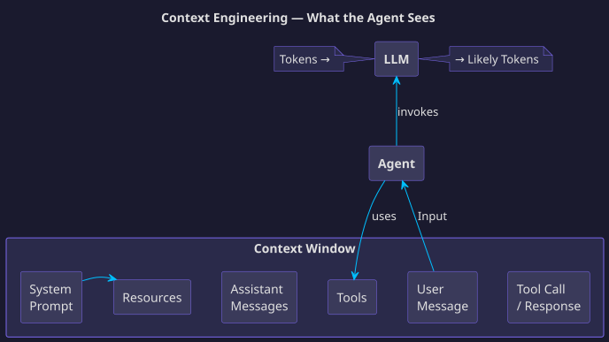
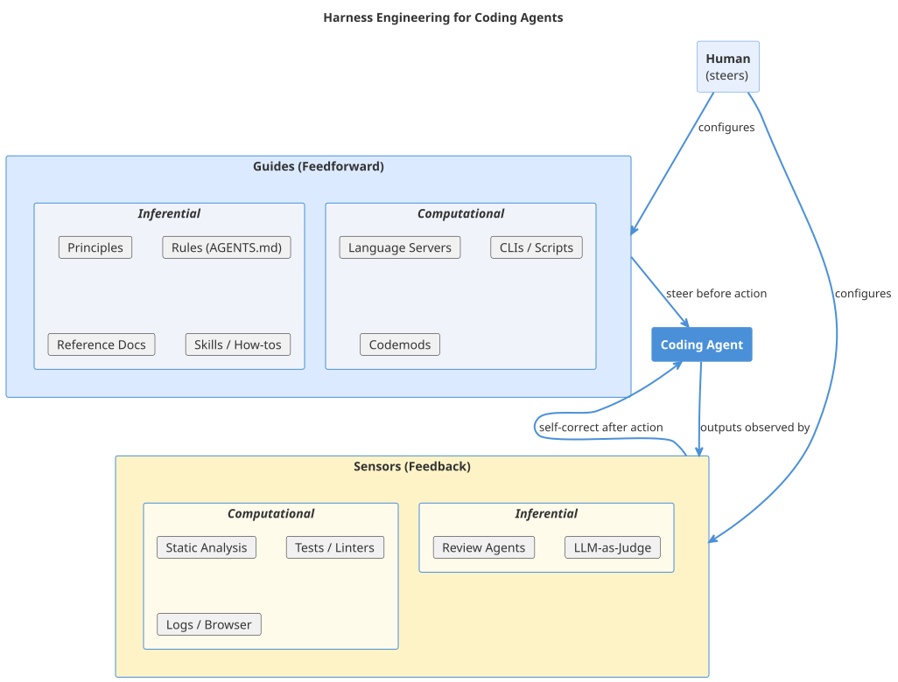

# Intro

## Table of Contents

- [Learning Objectives](#learning-objectives)
- [1. The Big Idea](#1-the-big-idea)
- [2. What You Will Build](#2-what-you-will-build)
- [3. Context Engineering](#3-context-engineering)
- [4. Harness Engineering](#4-harness-engineering)
- [5. Loop Engineering](#5-loop-engineering)
- [6. The SDLC Software Factory](#6-the-sdlc-software-factory)
- [7. Course Structure](#7-course-structure)
- [Key Takeaway](#key-takeaway)
- [References](#references)

## Learning Objectives

By the end of this module you will:

- Explain why AI agents need engineered context and constraints to follow a
  software development process reliably
- Describe the six parts of an agent's context window and how an agent
  config controls them in your harness (Kiro CLI, Pi, or OpenCode)
- Distinguish guides from sensors, and computational controls from
  inferential ones
- Describe an agent loop with a goal, a sensor, an exit condition, and an
  iteration cap, and relate it to TDD and BDD
- Explain what a software factory is and where each course module fits
- Know the course timeline, prerequisites, and how the agents build on each
  other

## 1. The Big Idea

Software development is more than writing code. It is a chain of processes:
planning, designing, specifying, building, testing, deploying, and
reviewing. Each process has conventions, templates, and rules. Humans follow
them manually, often inconsistently. AI agents can follow them precisely,
every time, but only if you engineer the right context and constraints
around them.

An agent is only as good as the processes you encode into it:

- A coding agent without architecture guidelines produces inconsistent code.
- An agent without commit conventions produces unreadable history.
- An agent without test requirements produces untested features.

This is not a course about using AI to write code for you. You learn each
process well enough to teach it to an agent, then encode it so the agent
follows it reliably.

## 2. What You Will Build

| Module | Agent | Covers |
|--------|-------|--------|
| 1. Git | Git agent | Issues, branches, commits, PRs |
| 2. Architecture | Architecture agent | arc42 docs, C4 diagrams, ADRs |
| 3. Requirements | Requirements agent | User stories, DDD, Pareto prioritization |
| 4. CI/CD | CI/CD agent | GitHub Actions, SAM deploy, test gates |
| 5. TDD/BDD | TDD/BDD agent | Multi-agent test system (RED-GREEN-REFACTOR) |
| 6. Final Project | All five agents | Individual kata, end to end |

Modules 1–5 are individual work and each produces one specialized agent.
Module 6 is an individual project where you combine all five agents to
complete a selected kata.

### The pattern

Every module follows the same cycle:

> Learn the process → Practice manually → Build an agent → Use the agent

You cannot automate what you do not understand, so each module starts with
theory and manual practice before you build the agent.

## 3. Context Engineering

### 3.1 What it is

An LLM takes tokens in and produces likely tokens out. An agent wraps the
LLM in a loop: it takes input, calls the LLM, uses tools, and repeats. The
quality of the agent's output depends on what is in its context window.

**Context engineering** is the discipline of controlling what goes into that
window. The model is fixed. You cannot change how it works, but you can
change everything around it.

The diagram shows two levels. At the LLM level, tokens go in and likely
tokens come out. At the agent level, an input triggers the agent, which uses
tools and calls the LLM in a loop. The context window is everything the LLM
sees when it generates a response.

### 3.2 What goes into the context window

| Part | Role |
|------|------|
| System prompt | Who the agent is and which rules it follows |
| Resources | Reference docs, templates, and examples loaded at start |
| Tools | Capabilities such as `read`, `edit`, `shell`, MCP servers. Kiro names them `fs_read` and `fs_write`. |
| User message | The task, with enough detail to act on |
| Conversation history | What the agent remembers from this session |
| Tool responses | Results of earlier actions (file contents, CLI output) |

### 3.3 In this course

Every agent config you build is a context engineering exercise. The course
supports three agent harnesses: [Kiro CLI](https://kiro.dev),
[Pi](https://pi.dev), and [OpenCode](https://opencode.ai). In all three you
configure the same three things:

- The system prompt.
- The resources, which load reference docs.
- The tools, which grant capabilities.

The file format differs. Kiro uses an agent JSON config, Pi uses a preset, and
OpenCode uses a Markdown file in `.opencode/agents/`. The context engineering is
the same. The [Kiro harness guide](../../docs/kiro.md),
[Pi harness guide](../../docs/pi.md), and
[OpenCode harness guide](../../docs/opencode.md) cover each format in detail.

A vague system prompt produces vague results. A precise prompt with
templates and examples produces precise results.

## 4. Harness Engineering

### 4.1 What it is

A **harness** is everything around the model that keeps it on track. Agent =
Model + Harness. Context engineering decides what goes into the window.
Harness engineering decides how to keep the agent on track: preventing
mistakes before they happen and catching them when they do.

For coding agents the harness has two parts:

- **Guides** are feedforward controls. They steer the agent before it acts
  and raise the chance of a good result on the first attempt.
- **Sensors** are feedback controls. They detect problems after the agent
  acts and let it self-correct before issues reach a human.

Think of a highway. Guides are the lane markings and sensors are the rumble
strips. Together they keep traffic safe without constant attention. The
human steers by improving both over time.

### 4.2 Guides and sensors

|  | Inferential (uses AI) | Computational (deterministic) |
|--|-----------------------|-------------------------------|
| **Guides** (before) | `AGENTS.md`, skills, principles, reference docs | Language servers, CLIs, scripts, codemods |
| **Sensors** (after) | Review agents, LLM-as-judge | Static analysis, linters, tests, logs |

Use both kinds. Computational controls are cheaper, faster, and more
reliable, so prefer them where they can do the job.

Examples from this course:

- A rule in the agent prompt saying "always use conventional commits" is a
  guide. The `commit-msg` hook that rejects a badly formatted commit is a
  sensor.
- Guides prevent mistakes. Sensors catch what the guides miss.

### 4.3 This course is a harness

Each module adds guides and sensors to your agent harness:

| Module | Guide | Sensor |
|--------|-------|--------|
| 1. Git | Commit conventions | Pre-commit hooks |
| 2. Architecture | arc42 template | PlantUML validation |
| 3. Requirements | Story format | Traceability check |
| 4. CI/CD | Deploy pipeline | Test gate |
| 5. TDD/BDD | Test naming | pytest RED/GREEN |

By Module 6 you have a harness that keeps your agents producing consistent,
high-quality output. You build it from scratch, so you understand every
piece.

## 5. Loop Engineering

An agent rarely gets the work right in one pass. It works in a **loop**: act,
check, correct, repeat. **Loop engineering** is designing that loop: what the
agent tries, how the result is checked, and when it stops.

Context engineering decides what the agent sees. Harness engineering decides
which guides and sensors surround it. Loop engineering decides how those
pieces repeat until the work is acceptable.

### 5.1 Parts of a loop

| Part | Role |
|------|------|
| Guide | Defines the goal for this iteration |
| Sensor | Judges the result of the iteration |
| Exit condition | Ends the loop when the sensor is satisfied |
| Iteration cap | Stops the loop if it does not converge |
| Escalation | Hands the problem to a human when the cap is hit |

Two failure modes to watch for:

- A loop without an exit condition runs forever.
- A loop with a weak sensor exits too early, with work that is not done.

### 5.2 How it relates to TDD and BDD

TDD and BDD are the clearest example of a loop you can hand to an agent:

| Loop part | TDD / BDD |
|-----------|-----------|
| Goal (guide) | A failing test (RED) |
| Sensor | The test run |
| Exit condition | The test passes (GREEN) |
| Second pass | REFACTOR with the same sensor, so cleanup cannot break behavior |
| Story-level exit | BDD acceptance scenarios pass, so the story is done |

RED-GREEN-REFACTOR is the inner loop for one unit of behavior. BDD
scenarios sit one level up and define when a whole story is finished. You
will see both failure modes in Module 5.

## 6. The SDLC Software Factory

A **software factory** is a repeatable pipeline: specifications go in, and
tested, deployed software comes out. It is not one clever agent. It is a
line of specialized agents with defined inputs, outputs, and checks between
them, so the result does not depend on who ran it or how the prompt was
worded that day.

| Factory concept | In this course |
|-----------------|----------------|
| Stations | One specialized agent per SDLC phase (Modules 1–5) |
| Quality control | The harness: guides in front of each station, sensors behind |
| Rework | Loops that let a station retry until its sensors pass |
| The line | Requirements → Architecture → Implementation (TDD/BDD) → CI/CD → Git and PR flow |
| People | Define the specs, set the rules, review the output |

The human role moves from typing code to designing the line: writing specs,
tuning the harness, and reviewing what comes out. In Modules 1–5 you build
the stations. In Module 6 you connect them into one line and run a real
project through it.

## 7. Course Structure

### 7.1 Timeline

| Days | Activity |
|------|----------|
| 1–2 | Module 1: Git (agent + exercise) |
| 3–4 | Module 2: Architecture (agent + kata design) |
| 5–6 | Module 3: Requirements (agent + kata stories) |
| 7–8 | Module 4: CI/CD (agent + pipeline exercise) |
| 9–12 | Module 5: TDD/BDD (multi-agent system + kata implementation) |
| 13–18 | Module 6: Final Project (individual kata, all agents) |
| 19–21 | Buffer, presentations, retrospective |

In Modules 1–5 you submit PRs for review. In Module 6 you use all five
agents to complete a selected kata.

### 7.2 Prerequisites

- GitHub account (free)
- An agent harness installed: Kiro CLI ([kiro.dev](https://kiro.dev)), Pi ([pi.dev](https://pi.dev)), or OpenCode ([opencode.ai](https://opencode.ai))
- Python 3.12+, Node 20, AWS SAM CLI
- Git and GitHub CLI (`gh`)
- Basic knowledge of Python, REST APIs, and React
- AWS student sandbox account (needed from Module 4 onward)

Module 1 walks you through the setup. If a tool is missing, the module shows
you how to install it.

### 7.3 Agents build on each other

| Module | Agent | Used by |
|--------|-------|---------|
| 1 | Git agent | Every later module, for commits and PRs |
| 2 | Architecture agent | Output feeds Module 3 |
| 3 | Requirements agent | Output feeds Module 5 |
| 4 | CI/CD agent | Module 6, for deployment |
| 5 | TDD/BDD agent | Module 6, for implementation |
| 6 | All agents together | One project |

The architecture agent's output becomes the input for the requirements
agent, and the requirements agent's output becomes the input for the TDD
agent. It is a pipeline, like real software development.

## Key Takeaway

You are not learning to use AI. You are learning software development
processes and encoding them into agents that follow those processes
precisely. The agents are the vehicle for that understanding, not the
destination.

## References

- [Harness Engineering (Fowler)](https://martinfowler.com/articles/harness-engineering.html)
- [Context Engineering (Fowler)](https://martinfowler.com/articles/exploring-gen-ai/context-engineering-coding-agents.html)
- [Spec-Driven Development (Fowler)](https://martinfowler.com/articles/exploring-gen-ai/sdd-3-tools.html)
- [What Is Loop Engineering? (IBM)](https://www.ibm.com/think/topics/loop-engineering)
- [Loop Engineering: Building Blocks, Adoption, and Impact (arXiv 2608.21884)](https://arxiv.org/abs/2608.21884)
- [Stop Hand-Holding Your Coding Agent: Engineering the Loops that Replace Step-by-Step Prompting (arXiv 2607.00038)](https://arxiv.org/abs/2607.00038)
- [What Is an Agentic Software Factory? (Sonar)](https://www.sonarsource.com/resources/library/what-is-an-agentic-software-factory/)
- [Architecting an Autonomous Software Factory: End-to-End Agentic Delivery (Google codelab)](https://codelabs.developers.google.com/codelabs/software-factory-end-to-end)
- [Kiro CLI](https://kiro.dev/docs/cli/)
- [Pi](https://pi.dev)
- [OpenCode](https://opencode.ai/docs/)
- Slides: [slides/intro.md](slides/intro.md)
